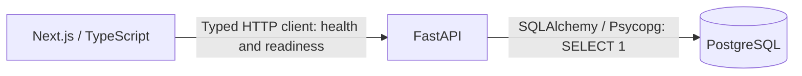

# Roamline

Personalized travel discovery and itinerary planning.

Travel planning often starts with scattered ideas, too many tabs, and generic lists. Roamline is intended to help travelers decide where to go and shape their days around their interests, pace, and comfort preferences.

## Two ways to begin

- **Discover a destination:** you know your dates and preferences, but have not chosen where to travel.
- **Plan an existing destination:** you know where you are going and want help choosing experiences and organizing your days.

## Current status

### Implemented

- Next.js landing page and honest `/discover` and `/plan` route shells.
- FastAPI `/health` liveness and `/ready` PostgreSQL connectivity check (503 when unavailable).
- Environment-based settings and explicit CORS allowlist.
- Typed frontend health/readiness client with response validation and request timeout. It is available as a boundary, not called during static page builds.
- Validated traveler preference schemas, without persistence or recommendation behavior.
- SQLAlchemy engine lifecycle, Alembic scaffolding, development Compose, and foundational CI/tests.

### Planned

Personalized destination ranking, multi-day itineraries, geographic/travel-time constraints, weather awareness, recommendation explanations, and replanning. Retrieval or orchestration tools will be considered only when a concrete feature requires them. None of these capabilities are implemented yet.

## Architecture



The landing page is static. Database access currently exists only for readiness; no application tables are created. The server owns its connection pool through FastAPI lifespan and disposes it on shutdown. Liveness never depends on database availability.

## Tech stack

Python 3.12+, FastAPI, Pydantic, pydantic-settings, SQLAlchemy 2.x, Psycopg 3, PostgreSQL 17, Alembic, pytest; Next.js App Router, React, TypeScript, ESLint; Docker Compose and GitHub Actions. Node.js 24 LTS is used for frontend development and CI. Frontend dependency versions are pinned with an npm lockfile; Python dependencies have compatible major-version bounds.

## Repository structure

```text
backend/
  app/api/            Operational endpoints
  app/core/           Configuration
  app/db/             Engine creation
  app/domain/         Traveler preference schemas
  app/main.py         Application factory and lifecycle
  tests/              Unit and optional PostgreSQL integration checks
  alembic/            Migration environment; no domain migrations yet
  pyproject.toml
  Dockerfile
frontend/
  app/                Landing page, discover and plan shells, shared styles
  components/         Journey cards and workflow shell
  lib/api.ts          Typed backend boundary
  public/
  Dockerfile
.github/workflows/ci.yml
docs/images/          Reserved for real application screenshots
.env.example
docker-compose.yml
```

## Local development

Prerequisites: Python 3.12+, Node.js 24 with npm, and a running PostgreSQL instance.

1. Copy `.env.example` to `.env` locally. Replace the placeholder password and use matching credentials for your database. Do not commit this file. `DATABASE_URL` must use `postgresql+psycopg://` and URL-encode special characters in credentials. For native development, use `localhost` as the database hostname.
2. Install and start the backend from the repository root:

   ```sh
   python -m venv backend/.venv
   # macOS/Linux:
   source backend/.venv/bin/activate
   # Windows PowerShell instead:
   # backend\.venv\Scripts\Activate.ps1
   python -m pip install -e "./backend[dev]"
   uvicorn app.main:create_app --factory --reload
   ```

   Settings read `.env` from the current working directory. API docs: <http://localhost:8000/docs>. Liveness: <http://localhost:8000/health>; readiness: <http://localhost:8000/ready>.
3. In another terminal:

   ```sh
   cd frontend
   npm ci
   # Set NEXT_PUBLIC_API_URL=http://localhost:8000 in frontend/.env.local
   # (or export it in your shell) when using the API client.
   npm run dev
   ```

   Open <http://localhost:3000>. Next.js does not automatically read the root `.env`. The public API URL is visible to browsers; never put secrets there. Production builds embed NEXT_PUBLIC values, so set the URL before building.

### Validation

```sh
# From backend, with the virtual environment activated:
python -m pytest
# From frontend:
npm run lint
npm run build
# From repository root (safe placeholders suffice for config validation):
docker compose --env-file .env.example config --quiet
git diff --check
```

The current npm audit reports a moderate development-tool advisory in the transitive minimatch dependency used by TypeScript ESLint (eight affected package entries). The suggested automatic fix downgrades the Next.js lint configuration across a major version, so it has not been applied. Track an upstream compatible fix. No production dependency is listed in this finding.

Tests mock successful/failed connections to verify readiness, liveness independence, startup/shutdown, configuration, CORS, and profile validation. Set `TEST_DATABASE_URL` to a disposable PostgreSQL URL to enable the real connectivity test; otherwise it is explicitly skipped. CI provides PostgreSQL and runs that integration test.

## Docker development

1. Copy `.env.example` to `.env`, choose a local password, and set `DATABASE_URL` to use **db** as hostname, not localhost. Keep the credentials consistent with `POSTGRES_*`. Keep `NEXT_PUBLIC_API_URL=http://localhost:8000` for requests from your browser.
2. Run:

   ```sh
   docker compose up --build
   ```

3. Open <http://localhost:3000>. Ports 3000, 8000, and 5432 bind only to loopback. PostgreSQL data lives in the `postgres_data` named volume. Backend and frontend source directories are mounted for development reload; rebuild after dependency/configuration changes.
4. Stop with `docker compose down`. This retains database data. `docker compose down --volumes` deletes it; only use that when you intend to reset your local database.

Database, backend readiness, and frontend HTTP health checks gate startup. The Dockerfiles target development, not hardened production deployment. No credentials are baked into images or provided as Compose defaults.

## Migrations and domain decisions

Alembic reads the same environment settings as the application. From `backend`, with `DATABASE_URL` exported, use `alembic upgrade head`. There are no migrations or domain tables yet. Create explicit migrations when persistence is justified; autogeneration will need declarative model metadata wired into `alembic/env.py` first.

`TravelerProfile` is a schema only. Optional preferences distinguish unknown values from explicit low/moderate/high choices. Interests, hobbies, activities, accessibility requirements, and comfort preferences remain flexible lists; walking and crowd preferences use small enums. No diagnoses, medical records, profile API, or storage are introduced.

## Engineering approach

Keep implemented behavior separate from product intent. Prefer clear module boundaries, explicit configuration, meaningful tests, and standard maintained libraries. Introduce persistence, integrations, and abstractions only when an implemented user journey needs them. The coastal landing-page illustration is CSS artwork, not a destination photo or an application screenshot.

## Recommended next milestone

Define and implement a traveler-preference intake workflow with accessible forms and validation, settle the profile contract, and then decide whether saving a profile requires persistence. Recommendation logic should follow a separate, explicitly scoped milestone.
