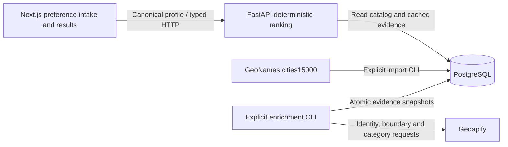

# Roamline

Personalized travel discovery and itinerary planning.

Travel planning often starts with scattered ideas, too many tabs, and generic lists. Roamline is intended to help travelers decide where to go and shape their days around their interests, pace, and comfort preferences.

## Two ways to begin

- **Discover a destination:** you know your dates and preferences, but have not chosen where to travel.
- **Plan an existing destination:** you know where you are going and want help choosing experiences and organizing your days.

## Current status

### Implemented

- Next.js landing page, a staged **Traveler Profile / Preference Intake** workflow at `/discover`, and an honest `/plan` route shell.
- `POST /api/v1/traveler-profile/validate` validates and returns a normalized canonical traveler profile without persistence.
- An editable, human-readable preference summary after successful backend validation.
- FastAPI `/health` liveness and `/ready` PostgreSQL connectivity check (503 when unavailable).
- Environment-based settings and explicit CORS allowlist.
- Typed frontend API boundary for health/readiness and profile validation, with timeouts and field-level validation errors.
- One canonical traveler profile reused for destination matching and future itinerary planning, without profile storage.
- GeoNames city catalog import and PostgreSQL migrations; a bounded, data-driven candidate policy.
- Explicit Geoapify city-boundary/POI enrichment: 22 unique categories, one per sequential request, with resumable category-level caching, original POI evidence, and deduplicated interest features.
- Deterministic interest-weighted destination ranking with score decomposition, unsupported-preference disclosure, and an honest result/empty-state UI.
- SQLAlchemy engine lifecycle, Alembic scaffolding, development Compose, and foundational CI/tests.


### Planned

Richer destination evidence and calibrated ranking, multi-day itineraries, geographic/travel-time constraints, weather awareness, and replanning. Retrieval or orchestration tools will be considered only when a concrete feature requires them. None of these capabilities are implemented yet.

## Architecture



Recommendation requests read prepared data only; they never call Geoapify or an LLM. Dates, weather, crowds, cost, walking and accessibility do not influence the current ranking. Read the [data, scoring, operations and limitations](docs/destination-ranking.md) for the precise contract. The provider adapter is implemented and tested with mocks. The controlled live Berlin run succeeded for five single-category requests, then stopped on a read timeout; no complete live snapshot was persisted. Live recommendation consumption remains unverified. See the detailed verification notes before attempting another run. A fresh setup displays honest data-readiness states until catalog and evidence have been prepared.


## Tech stack

Python 3.12+, FastAPI, Pydantic, pydantic-settings, SQLAlchemy 2.x, Psycopg 3, PostgreSQL 17, Alembic, HTTPX, pytest; Next.js App Router, React, TypeScript, ESLint; Docker Compose and GitHub Actions. Node.js 24 LTS is used for frontend development and CI. Frontend dependency versions are pinned with an npm lockfile; Python dependencies have compatible major-version bounds.

## Repository structure

```text
backend/
  app/api/            Operations, profile validation, destination recommendations
  app/core/           Configuration
  app/db/             Engine and destination/evidence models
  app/domain/         Profile and recommendation contracts, versioned feature mapping
  app/services/       Catalog, Geoapify adapter, enrichment, deterministic ranking
  app/cli.py          Explicit data preparation commands
  app/main.py         Application factory and lifecycle
  tests/              Unit and optional PostgreSQL integration checks
  alembic/            Explicit catalog and enrichment migrations
  pyproject.toml
  Dockerfile
frontend/
  app/                Landing page, discovery intake, plan shell, shared styles
  components/         Intake, summary, recommendation cards and shared controls
  lib/                Typed API client, profile contract, and form validation
  tests/              Node built-in tests; no added test dependency
  public/
  Dockerfile
.github/workflows/ci.yml
docs/images/          Real application screenshots
.env.example
docker-compose.yml
```

## Local development

Prerequisites: Python 3.12+, Node.js 24 with npm, and a running PostgreSQL instance.

1. Copy `.env.example` to `.env` locally. Replace the placeholder password and use matching credentials for your database. Do not commit this file. `DATABASE_URL` must use `postgresql+psycopg://` and URL-encode special characters in credentials. For native development, use `localhost` as the database hostname.
2. Install and start the backend from the repository root:

   ```sh
   python -m venv backend/.venv
   # macOS/Linux:
   source backend/.venv/bin/activate
   # Windows PowerShell instead:
   # backend\.venv\Scripts\Activate.ps1
   python -m pip install -e "./backend[dev]"
   uvicorn app.main:create_app --factory --reload
   ```

   Settings read `.env` from the current working directory. API docs: <http://localhost:8000/docs>. Liveness: <http://localhost:8000/health>; readiness: <http://localhost:8000/ready>.
3. In another terminal:

   ```sh
   cd frontend
   npm ci
   # Set NEXT_PUBLIC_API_URL=http://localhost:8000 in frontend/.env.local
   # (or export it in your shell) when using the API client.
   npm run dev
   ```

   Open <http://localhost:3000>. Next.js does not automatically read the root `.env`. The public API URL is visible to browsers; never put secrets there. Production builds embed NEXT_PUBLIC values, so set the URL before building.

### Validation

```sh
# From backend, with the virtual environment activated:
python -m pytest
# From frontend:
npm test
npm run lint
npm run build
# From repository root (safe placeholders suffice for config validation):
docker compose --env-file .env.example config --quiet
git diff --check
```

The current npm audit reports a moderate development-tool advisory in the transitive minimatch dependency used by TypeScript ESLint (eight affected package entries). The suggested automatic fix downgrades the Next.js lint configuration across a major version, so it has not been applied. Track an upstream compatible fix. No production dependency is listed in this finding.

Backend tests additionally cover catalog parsing/import, candidate selection, mocked provider identity/failures, feature normalization, scoring/weights, cache behavior and recommendation responses. Frontend tests cover typed recommendation requests, empty states, error handling and evidence labels. Backend tests also cover profile normalization, date/duration consistency, duplicate interests, enums, accessibility boundaries, API responses, POST CORS preflight, readiness, liveness independence, configuration, and lifecycle. Frontend tests use Node’s built-in test runner for form validation and typed API success/error behavior. Browser interactions should also be checked against the running stack; Chrome DevTools MCP is optional development tooling, not an application dependency. Set `TEST_DATABASE_URL` to a disposable PostgreSQL URL to enable the real connectivity test; otherwise it is explicitly skipped. CI provides PostgreSQL and runs that integration test.

## Docker development

1. Copy `.env.example` to `.env`, choose a local password, and set `DATABASE_URL` to use **db** as hostname, not localhost. Keep the credentials consistent with `POSTGRES_*`. Keep `NEXT_PUBLIC_API_URL=http://localhost:8000` for requests from your browser.
2. Run:

   ```sh
   docker compose up --build
   ```

3. Open <http://localhost:3000>. Ports 3000, 8000, and 5432 bind only to loopback. PostgreSQL data lives in the `postgres_data` named volume. Backend and frontend source directories are mounted for development reload; rebuild after dependency/configuration changes.
4. Stop with `docker compose down`. This retains database data. `docker compose down --volumes` deletes it; only use that when you intend to reset your local database.

Database, backend readiness, and frontend HTTP health checks gate startup. Apply `docker compose exec backend alembic upgrade head` before using destination APIs; readiness verifies connectivity, not schema or evidence availability. The Dockerfiles target development, not hardened production deployment. No credentials are baked into images or provided as Compose defaults.

## Migrations and domain decisions

Alembic reads the same environment settings as the application. From `backend`, with `DATABASE_URL` exported, use `alembic upgrade head`. The migrations create destinations, published enrichment snapshots, original per-category POI evidence, feature aggregates, and an independent resumable category work cache. Traveler profiles remain unpersisted. See [destination data operations](docs/destination-ranking.md#operations) to download/import GeoNames, inspect the bounded candidates, and explicitly enrich with Geoapify.

`TravelerProfile` is a validation-only contract, not a database entity. One profile supports destination discovery and will also support itinerary planning. Interests and hobbies share an extensible list of `{name, importance}` objects; names are whitespace-normalized and case-folded before duplicate detection. Other preferences use small enums, with `null` meaning no preference.

The contract includes:

- `travel_context`: optional city/country and dates, `duration_days` (1–365), and `flexible_dates`. Supply a duration or both dates. Both arrival and departure days count; paired dates derive duration or must match a supplied duration. A single date may be combined with a duration.
- `interests`: up to 30 weighted interests; importance is `low`, `moderate`, or `high`. Names and origin fields are limited to 80 characters.
- `travel_style`, `activity_level`, `walking_preference`, `weather_preference`, `weather_dislikes`, `crowd_preference`, and `trip_pace`.
- `accessibility`: travel-oriented requirement choices and an optional 500-character single-line note. No diagnoses or medical-history fields are collected. Unknown fields and control characters in free text are rejected.

### Profile validation API

`POST /api/v1/traveler-profile/validate` accepts a profile and returns the complete normalized profile with HTTP 200. Invalid input returns FastAPI’s HTTP 422 `detail` entries with field locations. It performs no database queries and does not save or log profile contents.

```json
{
  "travel_context": { "duration_days": 7, "flexible_dates": true },
  "interests": [{ "name": "photography", "importance": "high" }],
  "travel_style": "balanced",
  "weather_preference": "mild",
  "accessibility": { "requirements": ["avoid_many_stairs"] }
}
```

Open `/discover` to complete four progressive stages: trip context, interests, rhythm, and comfort. Fields use native accessible controls, preserve draft values while moving Back/Continue, and show inline errors. Backend validation is authoritative. A successful response displays a normalized summary with an Edit option. State exists only in memory; leaving or refreshing loses it. Nothing is saved in browser storage or PostgreSQL. After validation, request destination matches using this same profile. Cards show country/city, an evidence-match score, deterministic reasons, freshness and an expandable score decomposition. Only prepared, compatible feature evidence is used; unavailable data yields clear empty states. `/plan` remains a shell and can later reuse the same contract and preference controls.

## Engineering approach

Keep implemented behavior separate from product intent. Prefer clear module boundaries, explicit configuration, meaningful tests, and standard maintained libraries. Introduce persistence, integrations, and abstractions only when an implemented user journey needs them. The coastal landing-page illustration is CSS artwork, not a destination photo or an application screenshot.

## Recommended next milestone

Verify a small live Geoapify enrichment run with a configured key, inspect identity/boundary rejection rates and regional coverage, and evaluate/calibrate the current proxies against documented travel scenarios. Add further preference dimensions only when reliable evidence exists; itinerary planning remains a separate milestone.

## Destination data quick start

After applying migrations, with the backend virtual environment active and `DATABASE_URL` configured:

```sh
python -m app.cli download-geonames --directory .tmp/geonames
python -m app.cli import-geonames --cities .tmp/geonames/cities15000.zip --countries .tmp/geonames/countryInfo.txt
python -m app.cli candidates
# Set GEOAPIFY_API_KEY in the backend environment before this explicit step:
python -m app.cli enrich --limit 1 --dry-run --max-requests 25
# Only after reviewing the plan and authorizing provider usage:
python -m app.cli enrich --limit 1 --resume --max-requests 25
```

The default policy selects at most 40 cities with population >=100,000, interleaving continents and country rounds. Enrichment requests each of the 22 unique mapped categories once at `limit=20`, `lang=en`, without pagination or automatic retries. Place IDs are deduplicated within each interest union; shared POIs may support different interests. Each validated category response is committed independently, including successful zero-result responses. Resume skips fresh compatible categories; only a complete set of 22 categories can be published as an atomic recommendation snapshot. A failed run preserves successful category evidence and any prior complete snapshot. `--dry-run` prints the plan without network calls or writes; `--resume` is the default; `--max-requests` bounds all provider HTTP attempts; `--refresh` logically invalidates category caches while keeping the published snapshot until replacement succeeds. Category freshness uses `FEATURE_STALE_AFTER_DAYS` (30 by default), plus destination fingerprint, verified boundary, mapping version and query configuration checks. A fresh Berlin run does not fit the authorized 23-credit budget: 22 Places calls plus identity/boundary verification require at least 24 credits, and the current city-state polygon path costs more. Boundary result counts determine its exact cost. The CLI defaults to a 23-credit ceiling and refuses insufficient or unbounded plans before initializing an HTTP client. No fresh live run is currently authorized. Ranking uses `low=1`, `moderate=2`, `high=3` interest weights over log-transformed, capped availability and population-adjusted evidence. No unsupported interest silently contributes. GeoNames supplies canonical city data under CC BY 4.0; Geoapify supplies place evidence derived from © OpenStreetMap contributors (ODbL). Full [source attribution, exact policy, mappings, formula, refresh behavior and limitations](docs/destination-ranking.md) are documented separately. POI coverage is not travel quality; weather, accessibility, crowds, cost and travel dates are not evaluated.

The resumable implementation has mocked and PostgreSQL transaction coverage. No additional live Geoapify verification was performed for this change; a complete live enrichment and recommendation consumption remain unverified. Earlier successful observations were not persisted by the previous all-or-nothing implementation and cannot be recovered from this new cache.

Destination enrichment now uses a PostgreSQL-row-locked lease and durable generation fencing, with short transactions around state changes and no open transaction during provider waits. Stale/expired workers cannot write or publish. Boundary verification has its own timestamp and `BOUNDARY_STALE_AFTER_DAYS` policy (30 days); category responses do not renew it. `ENRICHMENT_LEASE_SECONDS` defaults to 180 seconds. GeoNames imports update source-owned fields only, preserving operational state. Another live run requires a reviewed, sufficient credit budget; `--max-requests` limits HTTP attempts and `--max-credits` defaults to 23.
